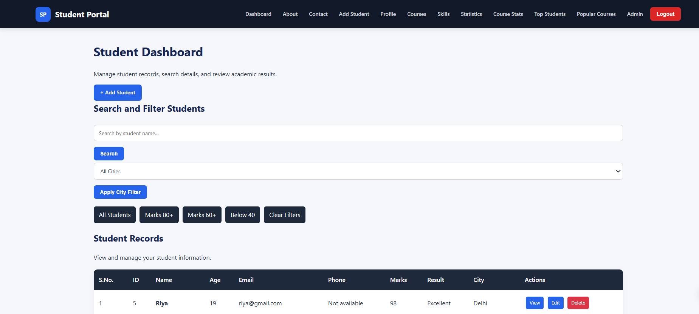
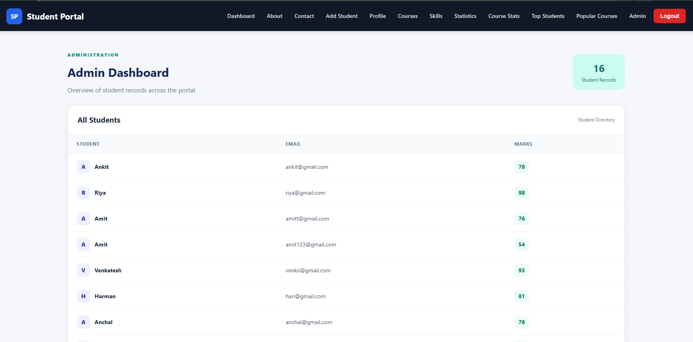
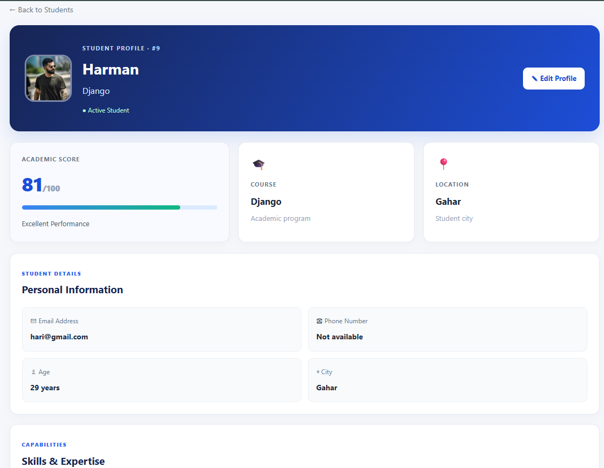
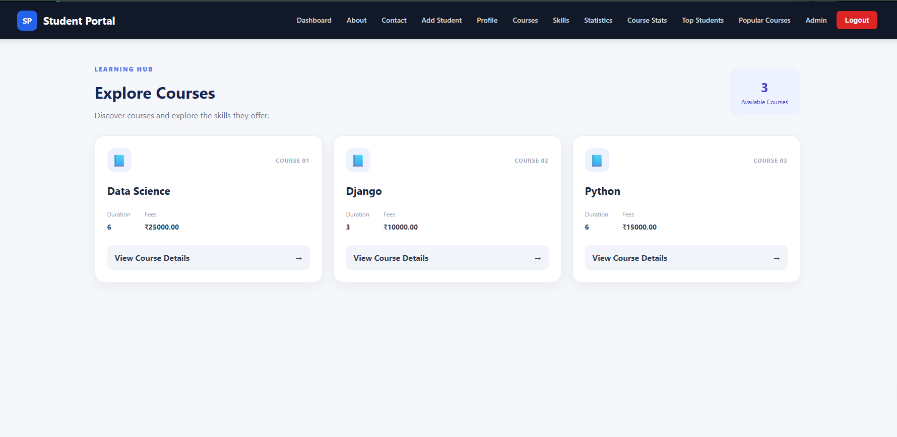
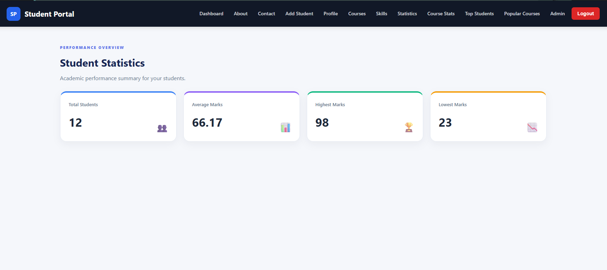

# Student Management Portal

A Django-based Student Management Portal for managing student records, courses, skills, and academic performance through a responsive web interface. The project includes authentication, user-scoped student management, dashboards, statistics, and a REST API.

> **Status:** Academic / portfolio project  
> **Built with:** Python · Django · Django REST Framework · HTML · CSS · SQLite

---

## Features

### Student Management
- Create, view, update, and delete student records
- Search students by name or city
- Filter records by city and marks
- Paginated student directory
- Student profile/detail pages
- User-scoped records so users manage their own students

### Courses & Skills
- Browse courses and skills
- View course and skill details
- Explore course statistics and popular courses

### Dashboard & Analytics
- Student statistics including total, average, highest, and lowest marks
- Top students ranking
- Course statistics and popular-course summaries
- Admin dashboard for administrative student oversight

### Accounts & Access
- User registration, login, logout, and profile page
- Protected pages for authenticated users
- Admin-only dashboard access
- Safe handling of post-login redirects

### REST API
- Django REST Framework student API
- Authenticated API access
- User-scoped student records
- Create and retrieve student data through API endpoints

---

## Screenshots

Add screenshots of the running application to the `screenshots/` folder, then update the filenames below if needed.

| Dashboard | Student Directory |
|---|---|
|  |  |

| Student Details | Course Listing |
|---|---|
|  |  |

| Statistics | Admin Dashboard |
|---|---|
|  | 

**Screenshot tips**
1. Run the app locally and capture the pages at a consistent browser width.
2. Save images using the filenames shown above inside `screenshots/`.
3. Avoid including real student personal information; use demo data.
4. Commit the screenshots alongside this README.

---

## Tech Stack

- **Backend:** Python, Django
- **API:** Django REST Framework
- **Frontend:** Django Templates, HTML, CSS
- **Database:** SQLite (default development database)
- **Authentication:** Django authentication system
- **Additional:** Django class-based views, pagination, signals, permissions

---

## Project Structure

```text
student-management-portal/
├── manage.py
├── requirements.txt
├── db.sqlite3                 # Local development database (usually not committed)
├── config/                    # Django project settings and root URLs
├── students/                  # Student, course, skill, views, URLs, API
├── templates/                 # Django HTML templates
├── static/
│   └── css/
│       └── style.css
└── screenshots/                # Add application screenshots here
```

> Adjust the app/project folder names in this section to match your repository if they differ.

---

## Getting Started

### 1. Prerequisites

Install:
- Python 3.10 or newer (use the version supported by your project dependencies)
- Git

### 2. Clone the repository

```bash
git clone https://github.com/Mohnish4246/Student-Portal.git
cd <YOUR_PROJECT_FOLDER>
```

Replace the repository URL and folder name with your own GitHub values.

### 3. Create and activate a virtual environment

**Windows (PowerShell):**
```powershell
python -m venv venv
.\venv\Scripts\Activate.ps1
```

**Windows (Command Prompt):**
```bat
python -m venv venv
venv\Scripts\activate
```

**macOS / Linux:**
```bash
python3 -m venv venv
source venv/bin/activate
```

### 4. Install dependencies

```bash
python -m pip install --upgrade pip
pip install -r requirements.txt
```

If the repository does not yet contain a `requirements.txt`, create one from the active environment:

```bash
pip freeze > requirements.txt
```

### 5. Apply database migrations

```bash
python manage.py migrate
```

### 6. Create an administrator account

```bash
python manage.py createsuperuser
```

Follow the prompts to set the username, email, and password.

### 7. Run the development server

```bash
python manage.py runserver
```

Open:

- Application: http://127.0.0.1:8000/
- Django Admin: http://127.0.0.1:8000/admin/

Register a regular user through the application to explore user-level features. Use the superuser account for Django Admin and any configured admin-only functionality.

---

## API

The project includes a Django REST Framework student API. The exact route prefix depends on the root URL configuration.

Typical router endpoints:

```text
GET     /api/students/       List the authenticated user's students
POST    /api/students/       Create a student record
GET     /api/students/{id}/  Retrieve a student record
PUT     /api/students/{id}/  Update a student record
PATCH   /api/students/{id}/  Partially update a student record
DELETE  /api/students/{id}/  Delete a student record
```

API requests require authentication according to the configured DRF authentication settings. Use the browsable API or an API client such as Postman to test the endpoints.

---

## Configuration

For local development, Django's default SQLite database is sufficient.

Before deploying publicly:
- Set `DEBUG = False`
- Configure `ALLOWED_HOSTS`
- Store `SECRET_KEY` in an environment variable
- Configure a production database if required
- Configure static-file collection and serving
- Use HTTPS and secure cookie settings
- Never commit passwords, API tokens, or production secrets

---

## Common Commands

```bash
# Validate Django configuration
python manage.py check

# Apply migrations
python manage.py migrate

# Create an admin user
python manage.py createsuperuser

# Run tests
python manage.py test

# Start development server
python manage.py runserver
```

---

## Future Improvements

- Add automated tests for views, permissions, and API endpoints
- Add CSV/Excel export for student records
- Add deployment configuration and production database support
- Add richer charts and downloadable reports

---

## Contributing

1. Fork the repository.
2. Create a feature branch: `git checkout -b feature/your-feature`
3. Commit your changes.
4. Push the branch and open a pull request.

For bug reports or suggestions, open an issue in the repository.

---

## License

This project is available for educational and portfolio use. Add a license file if you intend to grant specific reuse or distribution permissions.

---

## Author

**Mohnish Sharma**  
Student Management Portal · Django Project
